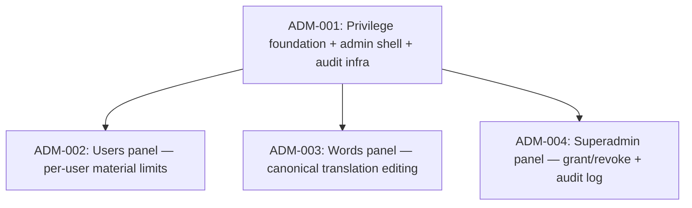

# SPEC-001 Admin Page — Issue Dependency Graph

## Legend

- Each **node** is a vertically-sliced, independently verifiable issue spanning
  every layer it needs (database / backend / frontend) to deliver user-observable
  behaviour.
- An **arrow** `A --> B` means B depends on A: A must be `done` before B can
  start, because B relies on a seam, schema, or capability that A establishes.
- **ADM-001** is the only root. It establishes the privilege model, the shared
  backend seams (guards, admin module, audit table + `recordAudit` helper,
  pass-through admin route factories in `api.js`), and the frontend admin shell
  (tab, subtabs, left rail, per-panel view-module stubs).
- **ADM-002, ADM-003, ADM-004** depend only on ADM-001 and can run **fully
  concurrently**. They never share files: each owns its own route file, its own
  admin-module service/repository files, and its own frontend panel
  controller/view files. All shared wiring (`api.js`, `modules/index.js`,
  `admin.controller.js`, `state.js`, `index.html` shell) is touched only in
  ADM-001. ADM-002 additionally owns the two materials enforcement files, which
  no other issue touches.
