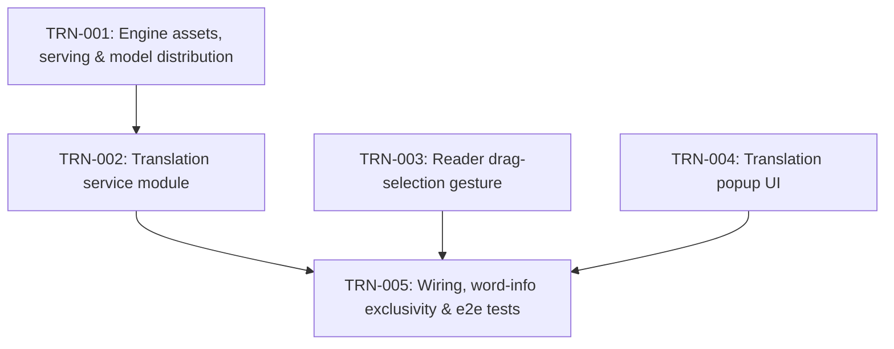

# SPEC-002 Reader Sentence Translation — Issue Dependency Graph

## Legend

- Each **node** is an issue. Unlike SPEC-001, these are component slices
  rather than vertical slices, by explicit user decision. Each component has
  a single owner and is independently verifiable through its public
  interface.
- An **arrow** `A --> B` means B depends on A: A must be `done` before B
  starts.
- **Interface contracts** join the slices. Each contract is copied verbatim
  into every issue that produces or consumes it, and must not be changed
  unilaterally:
  - **C1** asset URLs: TRN-001 → TRN-002 (and the TRN-005 test skip condition)
  - **C2** `translate()` / `TranslationError`: TRN-002 → TRN-005
  - **C3** `reader:segment-selected` event, `clearReaderSegmentSelection`,
    `isSegmentTranslationEligible`: TRN-003 → TRN-005
  - **C4** `openReaderTranslation` / `setReaderTranslationState` /
    `closeReaderTranslation` / `isReaderTranslationOpen`: TRN-004 → TRN-005
- **Parallelism:**
  - TRN-001, TRN-003 and TRN-004 are roots and share no files.
  - TRN-002 follows TRN-001 because it needs the served assets to verify
    against.
  - TRN-005 integrates everything. It is the only issue besides TRN-003 that
    touches `reader.controller.js`, and it only edits the word-info click
    handler, after TRN-003 is done.
- **Decisions applied to the spec's open questions:**
  - A selection must span at least 2 words.
  - Selection is limited to the visible page.
  - Unsupported browsers see an error in the popup.
  - Quick-menu actions are not available for Japanese→English readers.
