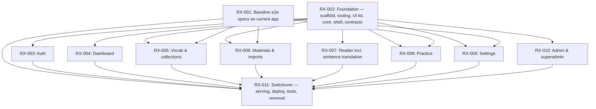

# SPEC-003 React Frontend Migration — Issue Dependency Graph

## Legend

- Each **node** is an issue. These are layer and feature slices, not
  vertical slices, by user decision. Consistency between them comes from the
  shared contracts.
- An **arrow** `A --> B` means B depends on A.
- **Contracts I1–I8** (routes, UI kit, API client, stores, i18n, shared app
  components, test hooks, cross-feature exports) are fixed by RX-002 and
  documented in `frontend/src/CONTRACTS.md`. Their summary is copied
  verbatim into every issue.
- **Layers:**
  1. RX-001 and RX-002 run in parallel.
  2. RX-003 to RX-010 run in parallel. Each owns only
     `frontend/src/features/<name>/`. The only shared file is
     `locales.json`, which receives additive, feature-prefixed keys and
     merges trivially. Spec-file edits are split by area (RX-007:
     reader-translation spec; RX-010: admin specs).
  3. RX-011 switches over.
- **Ownership:** RX-002 builds the auth welcome/login/language-gate path so
  e2e can run for every feature. Ownership of `features/auth/` then passes to
  RX-003.
- **Excluded from the acceptance bar:** the pre-existing login rate-limit
  (429) failures, tracked separately.
