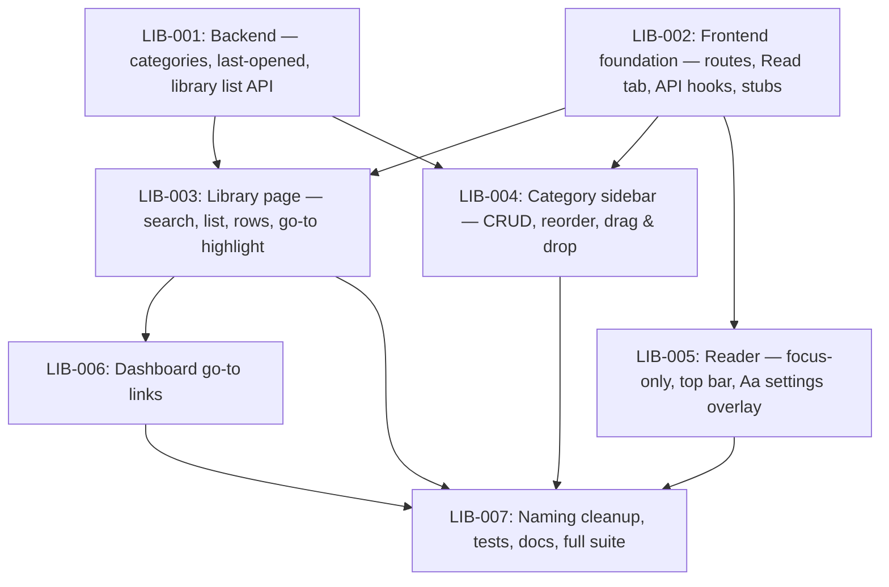

# SPEC-004 Library and Reader — Issue Dependency Graph

## Legend

- **Slicing:** nodes are issues sliced by area (backend, frontend foundation,
  Library, sidebar, Reader, dashboard, wrap-up), not vertically, by user
  decision.
- **Arrows:** `A --> B` means B needs A merged first.
- **Contracts:** C1 (API), C2 (routes and Library address), C3 (data hooks)
  and C4 (Library and sidebar connection) are copied verbatim into each
  issue that uses them, and recorded in CONTRACTS.md by LIB-002.
- **Layers:**
  1. LIB-001 and LIB-002 run in parallel.
  2. LIB-003, LIB-004 and LIB-005 run in parallel. They share only additive
     edits to `locales.json`, which merge-therapist handles.
  3. LIB-006.
  4. LIB-007.
