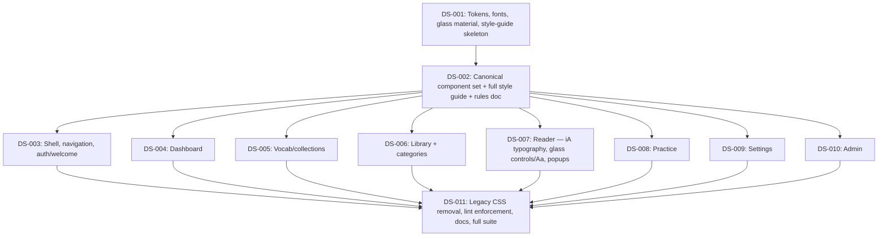

# SPEC-005 Design System Standardisation — Issue Dependency Graph

## Legend

- **Slicing:** nodes are layer and area slices (not vertical), by user
  decision.
- **Arrows:** `A --> B` means B needs A merged first.
- **User approval gate:** after DS-002, the user reviews and approves the
  look on /styleguide before DS-003..010 start.
- **Contracts:** D1 (design tokens and fonts), D2 (canonical component
  catalogue) and D3 (migration rules) are copied verbatim into the issues
  that use them and documented in CONTRACTS.md.
- **Parallel work:** DS-003..010 run in parallel. Each owns only its area's
  folders (DS-003 owns the AppShell consumer markup and shell.css) and must
  not edit components/ui, components/app internals or styles/. The only
  shared files are listed hook-preserving spec edits per area and rare
  locale additions, which merge-therapist handles.
- **Sequencing:** SPEC-005 starts after SPEC-004 (Library and Reader) is
  merged.
